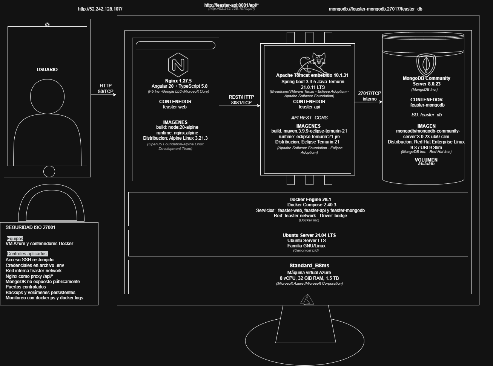

# FEASTER

Feaster es una red social de contenido gastronómico inspirada en Pinterest. Reúne publicaciones sobre recetas, productos gourmet, restaurantes y experiencias culinarias. Además de compartir contenido, los usuarios pueden seguir perfiles y organizar sus publicaciones favoritas en colecciones.

## Tecnologías


## Features

- Registro, inicio y cierre de sesión.
- Publicación y consulta de contenido gastronómico.
- Likes, comentarios y publicaciones guardadas.
- Perfiles públicos y seguimiento de usuarios.
- Colecciones públicas y privadas para organizar publicaciones.
- Permisos para modificar contenido propio y proteger colecciones privadas.

## Ejecución

Se necesita Docker con Docker Compose. Desde `feaster-backend`, preparar el archivo `.env`:

**Windows (PowerShell):**
```powershell
Copy-Item .env.example .env
notepad .env
```

**Linux y macOS:**
```bash
cp .env.example .env
```

Configurar `MONGO_ROOT_PASSWORD` en `.env` e iniciar los servicios:

```bash
docker compose up --build -d
```

Comprobar la API con `Invoke-RestMethod http://localhost:8081/api/health` en PowerShell o `curl http://localhost:8081/api/health` en Linux/macOS.

Para detener los servicios:

```bash
docker compose down
```

Las pruebas requieren JDK 21 y Maven:

```bash
mvn test
```

## Video de demo


[Ver video en YouTube](https://youtu.be/l_Yivm2yTo4)

## Desarrollo

### Elección de arquitectura

Elegí una arquitectura de tres capas porque Feaster necesita mostrar publicaciones y, al mismo tiempo, controlar quién puede crearlas, modificarlas o consultarlas. Por eso separé la interfaz, la lógica del backend y la base de datos: las operaciones como eliminar una publicación o abrir una colección privada se validan en la API, sin depender de lo que muestre la pantalla.

Además, organicé el backend en los contextos `auth`, `users`, `posts` y `collections` para mantener las reglas de cada funcionalidad en su propio módulo. De esta manera, puedo modificar las colecciones sin mezclar su lógica con el registro de usuarios o las publicaciones. También separé los controladores REST de los servicios y repositorios para mantener el acceso a MongoDB fuera de los endpoints.

### Decisión de tecnologías

Usé **Java 21 y Spring Boot** para desarrollar los endpoints y centralizar la autenticación, los permisos y las operaciones sociales. Por otro lado, elegí **MongoDB** para guardar usuarios, publicaciones e interacciones. Las imágenes y los videos se almacenaron aparte, mientras que en la base de datos guardé sus referencias.

Para la interfaz utilicé **Angular** porque el feed, los perfiles y las colecciones necesitan actualizarse después de cada interacción. Además, configuré **Nginx** para servir la web y dirigir las solicitudes al backend.

Finalmente, elegí **Docker Compose** para iniciar Angular/Nginx, Spring Boot y MongoDB en servicios separados dentro de una misma máquina virtual, sin tener que configurar y levantar cada uno por separado.

### Construcción del software

Implementé Feaster directamente en una máquina virtual Linux usando **Visual Studio Code y SSH**. Primero organicé los archivos en `/srv/feaster`, configuré MongoDB y preparé los datos iniciales. Después desarrollé los endpoints de autenticación, publicaciones, perfiles y colecciones. Además, probé las solicitudes HTTP con **Postman** mientras avanzaba con las funcionalidades.

Finalmente, conecté Angular con la API mediante Nginx. También guardé las imágenes y los videos en el almacenamiento de la máquina virtual y registré sus referencias en MongoDB. En este repositorio, el backend está organizado por contextos de negocio e incluye pruebas escritas con JUnit 5, Mockito y MockMvc.

### Despliegue en la nube

Desplegué Feaster en una máquina virtual de **Microsoft Azure con Ubuntu Server 24.04 LTS**. Para ejecutar los servicios, utilicé Docker Compose con contenedores separados para Angular/Nginx, Spring Boot y MongoDB. Así mantuve toda la aplicación en un mismo servidor, sin necesitar una máquina virtual para cada capa.

Además, configuré **Nginx en el puerto 80** para recibir las solicitudes y comunicarse con la API en el **8081**. Por otro lado, mantuve **MongoDB en el puerto 27017** solo para conexiones internas, sin exponer la base de datos a internet. Finalmente, conservé los datos de MongoDB y los archivos multimedia en almacenamiento persistente para que no se perdieran al reiniciar los contenedores.


